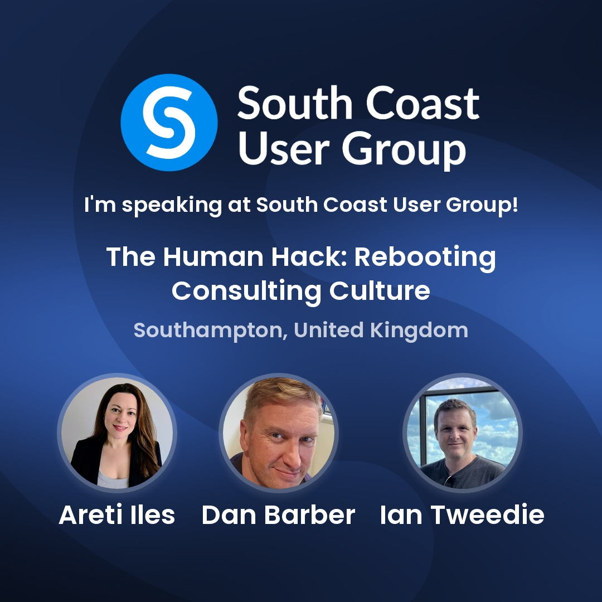

I'm heading to Southampton on **Friday 23 October** to present **The Human Hack: Rebooting Consulting Culture** at **South Coast User Group**. I'll be joining **Areti Iles** and **Dan Barber** at **11:00 BST**, bringing back the conversation we shared at Scottish Summit.

<!--more-->

## Join Us in Southampton

**Date:** Friday 23 October 2026\
**Our session:** 11:00 BST (UK time)\
**Venue:** Hilton Southampton - Utilita Bowl, Botley Road, West End, Southampton, SO30 3XH\
**Presenters:** Areti Iles, Dan Barber and Ian Tweedie\
**Registration and agenda:** [South Coast User Group on Meetup](https://www.meetup.com/mcscug/events/313077445/)

Please check the organiser's agenda for any updates to the programme.

## The Human Hack: Rebooting Consulting Culture

Technology keeps moving quickly, and AI is changing how we work. Good consulting still depends on understanding people, asking useful questions and building trust.

Following our [session at Scottish Summit](/events/261003-scottish-summit/), we're continuing the conversation about the culture behind successful consulting. How do we stay curious, challenge assumptions and understand the problem before reaching for a solution? How do we build teams and client relationships that make that possible?

Expect an honest, practical discussion, with stories from our experience and room for your questions. We'll explore how to keep the human experience at the centre of delivery while making good use of the technology available to us.

## What We'll Explore

- **Asking better questions:** Use curiosity and critical thinking to get to the root of a problem.
- **Building trust:** Create stronger client relationships through open communication and teamwork.
- **Improving consulting culture:** Give people the confidence to challenge assumptions and share ideas.
- **Delivering meaningful value:** Consider the impact of your work on people, processes and technology.

If you're a consultant, architect, delivery lead or someone helping teams through change, come along and bring your perspective.

## See You There

I'm looking forward to catching up with the South Coast community and meeting some new faces. Come and say hello, join the discussion, and share what good consulting culture looks like to you.

[Register and view the full programme on Meetup](https://www.meetup.com/mcscug/events/313077445/).
