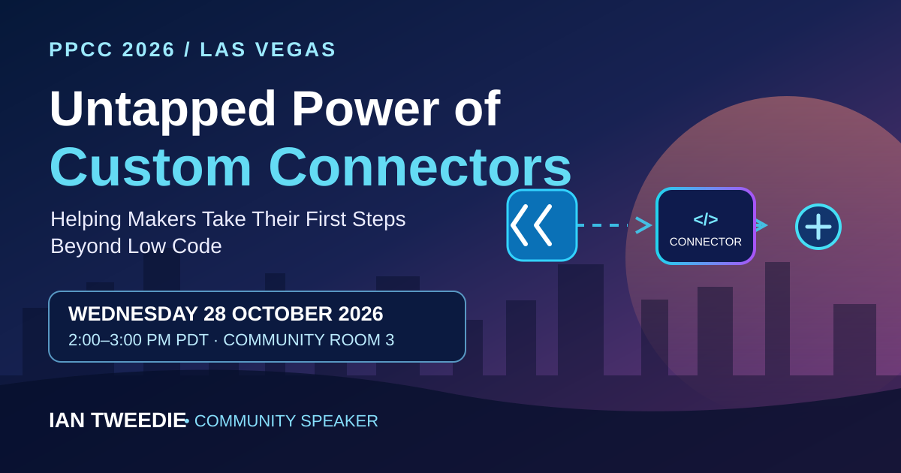

I'm heading to **Las Vegas** for the **Power Platform Community Conference (PPCC 2026)**, and I'll be presenting a session about one of my favourite ways to make Power Automate solutions easier to maintain: **custom connectors**.

If you've ever opened a flow and wondered how something so simple ended up needing 100 steps, this session is for you.

<!--more-->

## Where and When

**Event:** [Power Platform Community Conference 2026](https://www.powerplatformconf.com/)  
**Session:** Untapped Power of Custom Connectors: Helping Makers Take Their First Steps Beyond Low Code  
**Date:** Wednesday 28 October 2026  
**Las Vegas time:** 2:00–3:00 pm PDT (UTC−7)  
**UK time:** 9:00–10:00 pm GMT (UTC+0)  
**Room:** Community Room 3 — Power Automate, Power Apps & Power BI  
**Location:** Grand Ballroom 112, MGM Grand Conference Center, Las Vegas  
**Session length:** 60 minutes  
**Level:** 200 — Intermediate  
**Audience:** Makers and developers  
**Speaker:** Ian Tweedie (community speaker)

You can [view my session on the official PPCC 2026 website](https://www.powerplatformconf.com/sessions/Untapped-Power-of-Custom-Connectors%3A-Helping-Makers-Take-Their-First-Steps-Beyond-Low-Code) or explore the full conference programme.

## When Your Flow Has Outgrown Its Comfort Zone

Power Automate is incredibly effective as a low-code platform. For many scenarios, flows are all you need. But as solutions become more complicated, it's easy to end up with dozens or even hundreds of actions just to validate data, transform values or carry out a small piece of logic.

That complexity makes flows harder to understand, test and support. It can also mean solving the same problem in several places.

This session explores a different way of thinking: **sometimes introducing a small amount of code makes a solution simpler, not more complicated**.

Instead of maintaining fragile, 100-step flows, we'll look at how to move focused pieces of logic into a small, reusable integration layer and expose them through a custom connector. Your flows can then remain cleaner and easier to read.

## What We'll Explore

We'll use real-world examples to recognise situations where flow logic starts to struggle and see how a little **C#** can make a difference.

- **Spot the warning signs:** Recognise when a large, fragile flow suggests it's time to consider a custom connector.
- **Use only the code you need:** Understand how small, focused C# techniques can replace complex validation or transformation steps.
- **Build reusable integrations:** Encapsulate logic once rather than repeating it across multiple flows.
- **Reduce maintenance:** Keep Power Automate flows understandable while giving more complex logic a sensible home.
- **Gain confidence:** Get a practical mental model for taking your first steps beyond low code.

## Do I Need to Know C#?

**No.** This isn't a coding workshop, and you don't need any prior C# experience.

The focus is on the *approach*, rather than deep coding: knowing when a flow has reached its limits, recognising where a small amount of pro-code helps, and seeing how low-code and pro-code can work together within the Power Platform.

## See You in Las Vegas

If you're attending PPCC 2026, come along to **Community Room 3 at 2:00 pm on Wednesday 28 October**. Whether you're a maker curious about custom connectors or an experienced Power Automate developer looking for ways to simplify your solutions, I'd love to see you there.

[View the full session details and registration options](https://www.powerplatformconf.com/sessions/Untapped-Power-of-Custom-Connectors%3A-Helping-Makers-Take-Their-First-Steps-Beyond-Low-Code) and come and say hello after the session.

**#PPCC26 #PowerAutomate #PowerPlatform #CustomConnectors #LowCode #ProCode**
