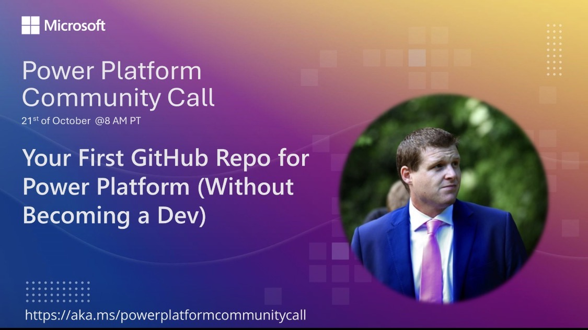

I’m presenting **Your First GitHub Repo for Power Platform (Without Becoming a Dev)** on the **Microsoft Power Platform Community Call** on **Wednesday 21 October 2026 at 4pm UK time**.

If you’ve wanted to try application lifecycle management (ALM), see what is being deployed, and check exactly what is changing, this session will help you take that first step with a reusable GitHub template.

<!--more-->

## Join the Community Call

- **When:** Wednesday 21 October 2026, **4:00pm UK time (BST)** / **8:00am Pacific (PDT)** / **3:00pm UTC**.
- **Speaker:** [Ian Tweedie](https://www.linkedin.com/in/iantweedie/).
- **Hosted by:** Microsoft Power Platform Community.
- **Join:** [Get the Power Platform Community Call calendar invitation](https://aka.ms/powerplatformcommunitycall).

Everyone is welcome. Use the invitation to add the call to your calendar and find the joining details.

## What I’ll Cover

The session walks through a practical route from a Power Platform solution to source control and deployment, using a template you can take away and try yourself:

- **Create your first repository from the template**, with GitHub Actions workflows already in place.
- **Connect to Power Platform** using a service principal, the required environment permissions, and GitHub secrets and variables.
- **Export a solution into GitHub** and review the committed changes so you can see what is being deployed.
- **Build a solution artifact** from the source in your repository.
- **Deploy to a target environment** and verify the solution import.

The aim is to make a first step into Power Platform ALM approachable for makers and consultants who are new to GitHub.

## Following Along

If you want to try the template yourself, you’ll need a GitHub account, a source Power Platform environment, a target environment, a solution, and the system administrator access needed for the setup.

## Slides and Resources

- [View the presentation slides](https://slides.mightora.io/deck/260715-your-first-github-repo/follower).
- [GitHub for Power Platform — reusable template and setup instructions](https://github.com/itweedie/github-for-powerplatform).
- [Session feedback, links and slides](https://feedback.iantweedie.biz/260715-your-first-github-repo).

This entry announces the upcoming live session; a recording is not available here yet.
